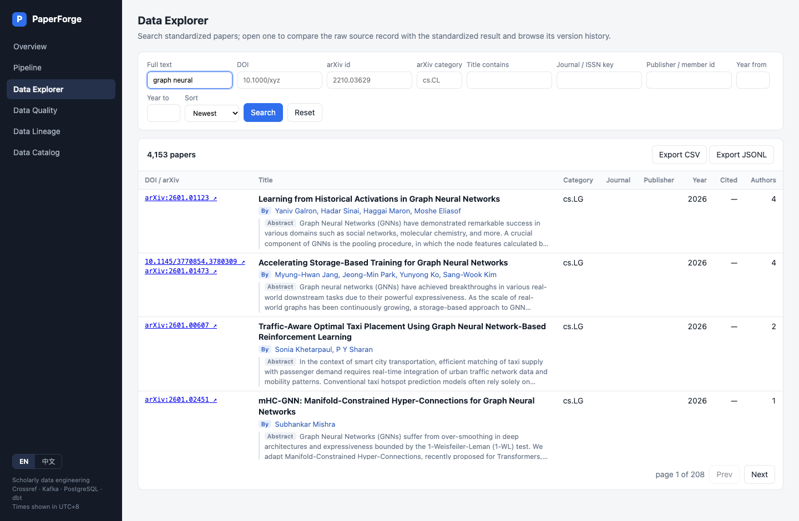
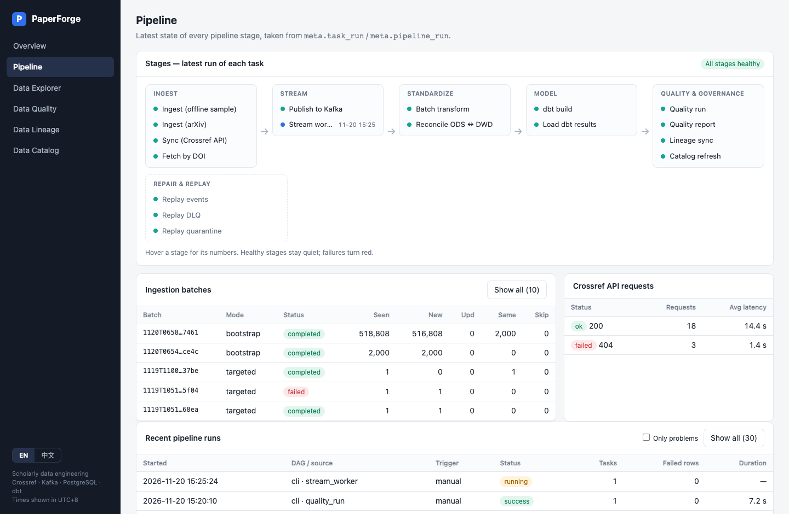
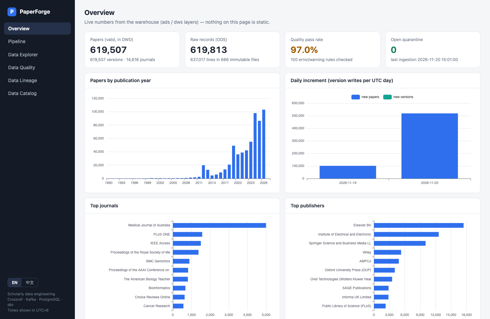

<div align="center">

# PaperForge

**A lightweight scholarly data-engineering platform** — from raw Crossref / arXiv records to a quality-checked, searchable paper warehouse, on one machine.

English · [简体中文](README.zh-CN.md)

</div>

PaperForge takes scholarly metadata through the whole data-engineering path:
ingestion → immutable raw archive → Kafka → standardization → warehouse (ODS / DWD / DIM / DWS / ADS) → data quality → lineage & catalog → API → web console.
It runs with Docker Compose and is built to be read: every layer has one job, every number can be traced back to the raw file and line it came from.



## Highlights

- **Two sources, one paper model.** Crossref journal articles and the arXiv metadata snapshot are merged by DOI; arXiv papers without a DOI become their own papers (`arxiv:<id>`). See [arXiv integration](docs/arxiv-integration.md).
- **Raw is immutable, everything else is rebuildable.** Every record lands in a JSONL file first (sha256 in a manifest); ODS keeps the latest source-native record; DWD can be rebuilt from raw at any time (`transform --rebuild`).
- **Batch and streaming share one core.** The same `ProcessingEngine` (Polars + Pandera) runs from raw files or from Kafka; offsets are committed only after the database commit, so lag 0 means processed.
- **Versioned papers.** Each paper keeps a timeline of distinct content versions; late, duplicate and out-of-order events converge to the same state.
- **Quality as a first-class citizen.** ~100 rules and checks (Pandera, SQL, ingest-time validators, dbt tests), a quarantine for bad records with replay, a daily report.
- **Lineage and catalog.** Dataset-level lineage from dbt manifests plus runtime edges, and a data catalog with real row counts.
- **Console.** React + ECharts, English / 中文, live numbers from the `ads` / `dws` layers.

| Pipeline | Overview |
|---|---|
|  |  |

## Architecture

```
Crossref API / offline dump ─┐                                      ┌─> dbt: stg → int → dim / dws / ads ─> FastAPI ─> React console
arXiv metadata snapshot ─────┴─> raw JSONL (immutable) ─> ods.* ─┬──┤
                                                                 │  └─> quality rules · lineage · catalog (meta.*)
                                         outbox ─> Kafka ─> worker ─> ProcessingEngine ─> dwd.*  (papers · versions · authors · references · identifiers)
                                                      batch: raw files ─────────────┘
```

| Layer | Schema | Written by | Role |
|---|---|---|---|
| ODS | `ods` | Python | latest source-native record per DOI / arXiv id + ingestion bookkeeping |
| DWD | `dwd` | Python | standardized papers, versions, authors, references, identifiers |
| DIM / DWS / ADS | `dim` `dws` `ads` | dbt | dimensions, statistics, search table for the API |
| META | `meta` | Python | checkpoints, quarantine, quality, catalog, lineage, run history |

Details: [data layers](docs/data-layers.md) · [all PostgreSQL tables and fields](docs/pg-tables.md) · [architecture](docs/architecture.md).

**Stack:** Python 3.12 · httpx + tenacity · Polars · Pandera · Kafka (KRaft) · PostgreSQL 17 · DuckDB · dbt-postgres · Airflow · FastAPI · React + TypeScript + ECharts · pytest.

## Quick start

Prerequisites: Docker (≥ 8 GB for the VM, 12 GB recommended), [uv](https://docs.astral.sh/uv/), Node 22+ (only for frontend development).

```bash
make setup          # python deps (uv, 3.12), frontend deps, .env
make up             # postgres, kafka, worker, api, web console
```

PaperForge does not ship any data. Get some in one of three ways:

```bash
# A) Live Crossref API — no download needed
uv run python -m paperforge.cli migrate
uv run python -m paperforge.cli sync --since 2026-11-17 --until 2026-11-17 --limit 300
make transform && make dbt && make quality

# B) Specific papers by DOI
make fetch-doi DOI=10.1016/j.radphyschem.2017.05.027 REFRESH=1

# C) Offline Crossref dump (parquet) and/or the arXiv snapshot
#    set CROSSREF_PARQUET_DIR in .env, then:
make demo                                                  # ingest 1,000 → Kafka → worker → dbt → quality → lineage
make ingest-arxiv ARXIV=~/Downloads/arxiv.zip N=2000       # trial; drop N for the whole default scope
make dbt
```

Then open the console at <http://localhost:5173> (EN / 中文 switch at the bottom of the sidebar) and the API docs at <http://localhost:8000/docs>.

| Command | What it does |
|---|---|
| `make ingest LIMIT=1000` | domain-stratified sample from the offline Crossref dump (`CROSSREF_PARQUET_DIR`) |
| `make ingest-arxiv ARXIV=… [CATS=… MATCH=any N=…]` | import a category-scoped slice of the arXiv snapshot (streamed from the zip) |
| `make fetch-doi DOI=… [REFRESH=1]` | targeted ingestion of specific DOIs through the streaming path |
| `make transform` | Batch Mode: raw JSONL → DWD (same engine as streaming) |
| `make publish` | announce ODS rows to Kafka; the `worker` container writes DWD |
| `make dbt` | `dbt build` (models + tests) → record results, lineage, catalog |
| `make quality` | all quality rules + daily report; exit 1 if an Error rule fails |
| `make replay [BATCH=id]` | replay raw files as events |
| `make status` | Kafka lag + end-to-end gap (broker ack ≠ processed) |
| `make airflow-up` | optional Airflow on <http://localhost:8080> (DAGs: bootstrap, incremental, daily, replay) |
| `make test` / `make test-all` | unit tests / unit + integration + e2e (isolated databases, topics, dbt targets) |
| `make down` | stop everything |

### arXiv

`make ingest-arxiv` reads the [Kaggle arXiv metadata snapshot](https://www.kaggle.com/datasets/Cornell-University/arxiv) (`arxiv-metadata-oai-snapshot.json`, or the zip containing it) as a stream; it is never extracted.
The default scope is core AI categories by *primary* category (`cs.AI cs.CL cs.LG cs.CV cs.IR cs.DL cs.MA cs.NE stat.ML`); change it with `CATS="cs.*,stat.ML" MATCH=any`.
Papers with a DOI merge with the same DOI (a Crossref paper only gains an arXiv identifier and categories); papers without one become `arxiv:<id>`. Run `make dbt` afterwards so search and statistics see the new data.

### Targeted ingestion by DOI

`make fetch-doi DOI=<doi> [DOI2 …]` (or `paperforge fetch-doi <doi>... [--file dois.txt]`; bare DOIs, `doi:` and `https://doi.org/` forms are accepted).
Each DOI is one work unit: `GET /works/{doi}` → immutable raw file → `ods.crossref_works` → outbox → Kafka → worker → DWD. It does not touch the sync watermark; an unknown DOI (404) or a non-`journal-article` fails only its own unit.
The worker updates DWD within seconds, but the console's search and statistics read dbt tables: add `REFRESH=1` to wait for the worker and run `dbt build`.

## Repository layout

```
src/paperforge/  connectors · ingestion · events · storage · processing · repositories · quality · lineage · workers · api · config
dbt/             models (staging · intermediate · marts/{dim,dws,ads}) · tests · macros
airflow/dags/    4 DAGs (schedule only)          frontend/   React + TS + ECharts console
migrations/      SQL migrations (001–007)         tests/      unit · integration · e2e · fixtures
docs/            architecture · er · data dictionary · dbt DAG · arXiv integration · test report · stage reports
```

## Documentation

> Most design documents under `docs/` are written in Chinese.

- [Architecture (as built)](docs/architecture.md) · [original plan](docs/00-architecture-plan.md)
- [Data layers: ODS / DWD / DIM / DWS / ADS](docs/data-layers.md) · [PostgreSQL tables and fields](docs/pg-tables.md)
- [arXiv integration](docs/arxiv-integration.md) · [ER diagrams](docs/er.md) · [Data dictionary](docs/data_dictionary.md) · [dbt model DAG](docs/dbt-dag.md)
- [Test report](docs/test_report.md) · [Acceptance checklist](docs/acceptance.md) · [versions](docs/versions.md)
- Stage reports: [1](docs/stage1-report.md) · [2](docs/stage2-report.md) · [3](docs/stage3-report.md) · [4](docs/stage4-report.md) · [5](docs/stage5-report.md) · [6](docs/stage6-report.md)

## Data and licensing

No data is included in this repository. Crossref metadata and the arXiv metadata snapshot are subject to their providers' terms; check them before redistributing anything derived from them.

## Honest limitations

- Single node, single Kafka broker, replication factor 1.
- "Domain coverage" for Crossref sampling is a heuristic (DOI prefixes + journal-name keywords), not a subject classifier.
- Dimensions are identifier-based only (no name-based entity matching); sources are merged by DOI only, never by title or author similarity.
- arXiv is a one-off snapshot import (no OAI-PMH incremental), has no citation edges, and its papers do not appear in journal / publisher statistics.
- Full-text search uses PostgreSQL's `simple` configuration (no stemming); there is no vector search yet.
- Airflow DAGs were verified with `airflow dags test`, not with a full scheduled day. See [acceptance](docs/acceptance.md) for the full list.
