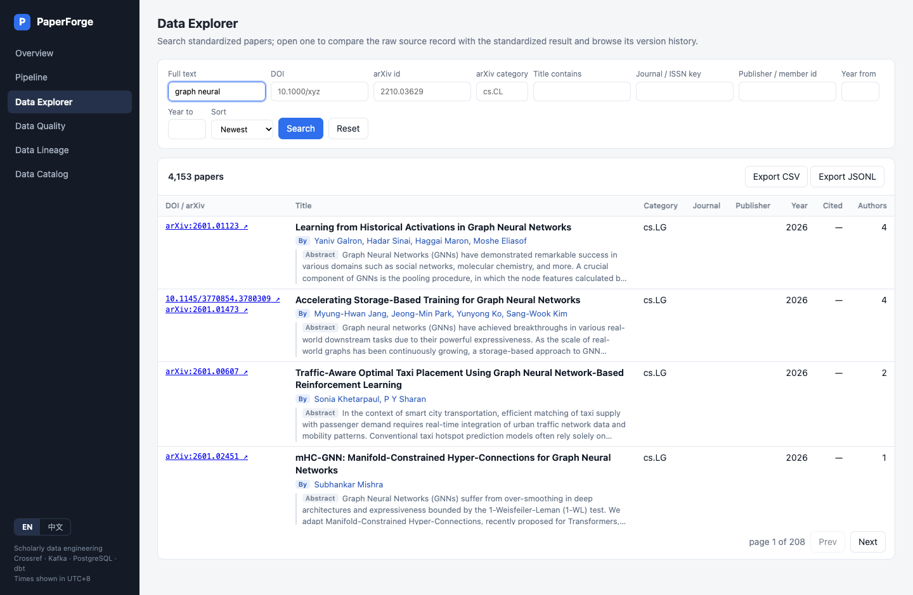
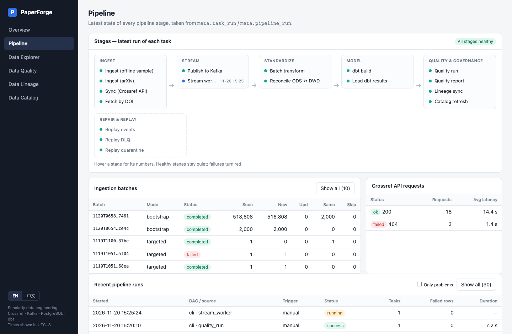
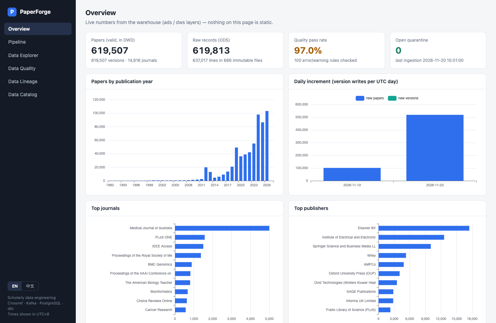

<div align="center">

# PaperForge

**轻量级学术数据工程平台**——在一台机器上，把 Crossref / arXiv 的原始记录做成经过质量检查、可检索的论文数据仓库。

[English](README.md) · 简体中文

</div>

PaperForge 覆盖学术元数据的完整数据工程链路：
采集 → 不可变原始归档 → Kafka → 标准化 → 数据仓库（ODS / DWD / DIM / DWS / ADS）→ 数据质量 → 血缘与目录 → API → Web 控制台。
用 Docker Compose 运行，并且为“可读懂”而设计：每一层职责单一，每个数字都能追溯到它来自哪个原始文件的哪一行。



## 特点

- **两个数据源，一个论文模型。** Crossref 期刊论文和 arXiv 元数据快照按 DOI 合并；没有 DOI 的 arXiv 论文自成一篇（`arxiv:<id>`）。详见 [arXiv 接入说明](docs/arxiv-integration.md)。
- **原始数据不可变，其余都可重建。** 每条记录先落成 JSONL 文件（清单里记录 sha256）；ODS 保存最新的来源原始记录；DWD 可随时从原始文件重建（`transform --rebuild`）。
- **批处理与流式共用一个核心。** 同一个 `ProcessingEngine`（Polars + Pandera）既处理原始文件也处理 Kafka；偏移量在数据库提交之后才提交，所以 lag 为 0 就代表处理完成。
- **论文有版本。** 每篇论文保留内容版本时间线；迟到、重复、乱序的事件最终收敛到同一状态。
- **质量是一等公民。** 约 100 条规则与检查（Pandera、SQL、摄取时校验、dbt 测试），坏数据进入隔离区并可重放，每日出报告。
- **血缘与目录。** 数据集级血缘（dbt manifest + 运行时登记），目录里带真实行数。
- **控制台。** React + ECharts，中英文切换，数字实时来自 `ads` / `dws` 层。

| 流水线 | 总览 |
|---|---|
|  |  |

（截图为英文界面，控制台可切换中文。）

## 架构

```
Crossref API / 离线数据 ─┐                                         ┌─> dbt: stg → int → dim / dws / ads ─> FastAPI ─> React 控制台
arXiv 元数据快照 ────────┴─> 原始 JSONL（不可变）─> ods.* ─┬───────┤
                                                           │       └─> 质量规则 · 血缘 · 目录（meta.*）
                                    outbox ─> Kafka ─> worker ─> ProcessingEngine ─> dwd.*（论文 · 版本 · 作者 · 参考文献 · 标识符）
                                                 批处理：原始文件 ──────────┘
```

| 层 | schema | 谁写入 | 作用 |
|---|---|---|---|
| ODS | `ods` | Python | 每个 DOI / arXiv 编号的最新来源原始记录 + 摄取记账 |
| DWD | `dwd` | Python | 标准化后的论文、版本、作者、参考文献、标识符 |
| DIM / DWS / ADS | `dim` `dws` `ads` | dbt | 维度、统计、供 API 检索的应用表 |
| META | `meta` | Python | 断点、隔离区、质量、目录、血缘、运行记录 |

详见：[数据分层](docs/data-layers.md) · [所有 PostgreSQL 表与字段](docs/pg-tables.md) · [架构](docs/architecture.md)。

**技术栈：** Python 3.12 · httpx + tenacity · Polars · Pandera · Kafka (KRaft) · PostgreSQL 17 · DuckDB · dbt-postgres · Airflow · FastAPI · React + TypeScript + ECharts · pytest。

## 快速开始

前置条件：Docker（虚拟机内存 ≥ 8 GB，建议 12 GB）、[uv](https://docs.astral.sh/uv/)、Node 22+（仅前端开发需要）。

```bash
make setup          # Python 依赖（uv，3.12）、前端依赖、.env
make up             # postgres、kafka、worker、api、Web 控制台
```

PaperForge 不附带任何数据，有三种方式获取：

```bash
# A）直接用 Crossref 在线 API，无需下载
uv run python -m paperforge.cli migrate
uv run python -m paperforge.cli sync --since 2026-11-17 --until 2026-11-17 --limit 300
make transform && make dbt && make quality

# B）按 DOI 指定论文
make fetch-doi DOI=10.1016/j.radphyschem.2017.05.027 REFRESH=1

# C）Crossref 离线数据（parquet）和/或 arXiv 快照
#    先在 .env 里设置 CROSSREF_PARQUET_DIR，然后：
make demo                                                  # 采集 1,000 条 → Kafka → worker → dbt → 质量 → 血缘
make ingest-arxiv ARXIV=~/Downloads/arxiv.zip N=2000       # 试跑；去掉 N 导入默认范围的全部
make dbt
```

然后打开控制台 <http://localhost:5173>（侧栏底部可切换 EN / 中文）和 API 文档 <http://localhost:8000/docs>。

| 命令 | 作用 |
|---|---|
| `make ingest LIMIT=1000` | 从 Crossref 离线数据（`CROSSREF_PARQUET_DIR`）按领域分层抽样 |
| `make ingest-arxiv ARXIV=… [CATS=… MATCH=any N=…]` | 导入 arXiv 快照中按分类选定的部分（从 zip 流式读取） |
| `make fetch-doi DOI=… [REFRESH=1]` | 走流式路径定向采集指定 DOI |
| `make transform` | 批处理：原始 JSONL → DWD（与流式同一引擎） |
| `make publish` | 把 ODS 行通知到 Kafka，由 `worker` 容器写入 DWD |
| `make dbt` | `dbt build`（模型 + 测试）→ 记录结果、血缘、目录 |
| `make quality` | 运行全部质量规则并生成每日报告；Error 级规则失败则退出码为 1 |
| `make replay [BATCH=id]` | 把原始文件重放为事件 |
| `make status` | Kafka lag 与端到端差距（broker 确认 ≠ 已处理） |
| `make airflow-up` | 可选的 Airflow，<http://localhost:8080>（DAG：bootstrap、incremental、daily、replay） |
| `make test` / `make test-all` | 单元测试 / 单元 + 集成 + 端到端（使用隔离的数据库、topic、dbt 目标） |
| `make down` | 停止所有服务 |

### arXiv

`make ingest-arxiv` 流式读取 [Kaggle 的 arXiv 元数据快照](https://www.kaggle.com/datasets/Cornell-University/arxiv)（`arxiv-metadata-oai-snapshot.json`，或包含它的 zip），不会解压到磁盘。
默认范围是**主分类**属于 AI 核心的论文（`cs.AI cs.CL cs.LG cs.CV cs.IR cs.DL cs.MA cs.NE stat.ML`），可用 `CATS="cs.*,stat.ML" MATCH=any` 调整。
带 DOI 的论文与同 DOI 的论文合并（Crossref 论文只会多出 arXiv 标识和分类）；没有 DOI 的成为 `arxiv:<id>`。导入后运行 `make dbt`，搜索和统计才能看到新数据。

### 按 DOI 定向采集

`make fetch-doi DOI=<doi> [DOI2 …]`（或 `paperforge fetch-doi <doi>... [--file dois.txt]`；支持裸 DOI、`doi:` 和 `https://doi.org/` 形式）。
每个 DOI 是一个工作单元：`GET /works/{doi}` → 不可变原始文件 → `ods.crossref_works` → outbox → Kafka → worker → DWD。不影响增量同步水位线；Crossref 不认识的 DOI（404）或非 `journal-article` 只会让它自己的单元失败。
worker 几秒内更新 DWD，但控制台的搜索和统计读的是 dbt 表：加 `REFRESH=1` 会等待 worker 完成并运行 `dbt build`。

## 目录结构

```
src/paperforge/  connectors · ingestion · events · storage · processing · repositories · quality · lineage · workers · api · config
dbt/             模型（staging · intermediate · marts/{dim,dws,ads}）· 测试 · 宏
airflow/dags/    4 个 DAG（只负责调度）          frontend/   React + TS + ECharts 控制台
migrations/      SQL 迁移（001–007）             tests/      unit · integration · e2e · fixtures
docs/            架构 · ER · 数据字典 · dbt DAG · arXiv 接入 · 测试报告 · 阶段报告
```

## 文档

> `docs/` 下的设计文档大部分是中文。

- [架构（实际实现）](docs/architecture.md) · [最初方案](docs/00-architecture-plan.md)
- [数据分层：ODS / DWD / DIM / DWS / ADS](docs/data-layers.md) · [PostgreSQL 表与字段](docs/pg-tables.md)
- [arXiv 接入](docs/arxiv-integration.md) · [ER 图](docs/er.md) · [数据字典](docs/data_dictionary.md) · [dbt 模型 DAG](docs/dbt-dag.md)
- [测试报告](docs/test_report.md) · [验收清单](docs/acceptance.md) · [版本](docs/versions.md)
- 阶段报告：[1](docs/stage1-report.md) · [2](docs/stage2-report.md) · [3](docs/stage3-report.md) · [4](docs/stage4-report.md) · [5](docs/stage5-report.md) · [6](docs/stage6-report.md)

## 数据与授权

本仓库不包含任何数据。Crossref 元数据和 arXiv 元数据快照受各自提供方的条款约束，再分发由它们派生的数据前请先确认。

## 已知限制

- 单节点、单个 Kafka broker、副本数 1。
- Crossref 抽样的“领域覆盖”是启发式（DOI 前缀 + 期刊名关键词），不是学科分类器。
- 维度只基于标识符（没有按名称的实体匹配）；来源之间只按 DOI 合并，不按标题或作者相似度合并。
- arXiv 是一次性快照导入（没有 OAI-PMH 增量），没有引用关系，其论文不进入期刊 / 出版社统计。
- 全文检索使用 PostgreSQL 的 `simple` 配置（无词干）；暂无向量检索。
- Airflow DAG 用 `airflow dags test` 验证过，没有做完整的一天调度验证。完整列表见[验收清单](docs/acceptance.md)。
