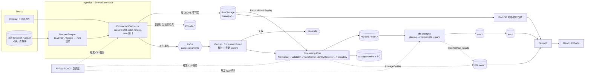
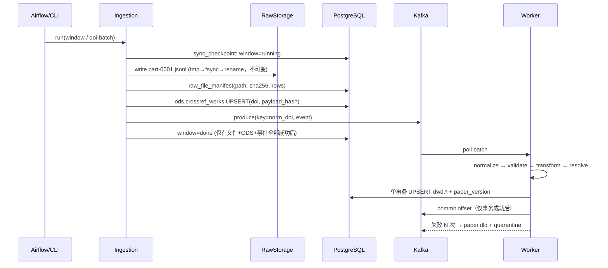

# PaperForge 架构设计与实施计划（v0.1，待确认）

> 状态：设计稿。确认前不写业务代码。文中凡标注「待实测」的版本/数字，均须在阶段 0 用 `uv lock` / `docker compose pull` 实际验证后回填，当前不视为已验证事实。

## 0. 本机环境勘察结果（已实测）

| 项 | 结果 | 影响 |
|---|---|---|
| Python | 系统 3.14.7；uv 管理的 3.12.13 可用 | 项目用 `uv` 固定 3.12，不用系统 Python |
| Docker / Compose | 29.4.3 / v5.1.3 | 满足 |
| Node | v26.13 | 前端建议 `.nvmrc` 锁 LTS（Node 22/24），避免 Vite/依赖不兼容 |
| DuckDB CLI | 1.5.6 | 可直接勘察 Parquet |
| psql | 未安装 | 通过容器内 psql / Python 访问 |
| 内存 / 磁盘 | 24 GB / 可用 505 GB | 够用；Kafka+PG+Airflow 同开需限制内存 |
| 离线数据 | `/path/to/crossref/parquet`（`CROSSREF_PARQUET_DIR`）：73 个 part，共 191 GB，每个 part 250 万行（总量约 1.8 亿，未逐一核实） | 只读使用，**绝不拷贝全量** |

### 离线 Parquet 的关键事实（影响设计，需要你决策）

1. **不是 API 原始 JSON，而是已展平的列式表**：`title/ISSN/container-title` 是 `varchar[]`，`author/reference/issued/indexed/...` 是 JSON 字符串列，另有 `year`、`score`。
2. **没有 `subject` 列**（Crossref API 才有），所以"生命科学/生物信息/计算机/医学"的领域覆盖无法直接按学科字段筛选。
3. 有 `indexed`（含 timestamp）、`deposited`、`created`，可用于增量水位线演示。
4. part-00000 中 journal-article 占约 72.5%，其中约 38.8% 有摘要，约 99% 有 ISSN（仅单个 part 的抽样）。

→ 这直接冲击两条需求："保存**完整原始 JSON**"与"领域覆盖"。见 §3 的方案与待确认问题。

---

## 1. 总体架构（模块化单体 + 独立 Worker）



**关键原则**
- Kafka 只负责传输与解耦；"链路成功"= PG 中 DWD 已提交，之后才 commit offset。
- Batch 与 Streaming 调用同一个 `process_records(records) -> ProcessResult`；两条路径只是"读取记录的来源"不同。
- Airflow 只发起命令（`python -m paperforge.cli …`），不含清洗逻辑；Consumer 是独立容器。
- Parquet 永远是可由 JSONL 重新生成的派生物；唯一性/事务只靠 PG。

## 2. 数据流（端到端）



**一致性边界**：ODS 写入先于 Kafka 发布（outbox 思路：以 `ods.crossref_works.published_at IS NULL` 为待发布集合，崩溃后可补发）。因此"Kafka 丢消息"可由 ODS 重放；"重复发布"由下游幂等吸收。

## 3. 数据接入方案（已按反馈修订）

**原则：来源无关。** 原始层保存"来源原生记录"（不要求逐字 API JSON）；来源差异只存在于 Connector 与 Normalizer 的字段映射；DWD 及以下全部面向统一标准，dbt 只依赖标准层。

1. `CrossrefParquetConnector`：用 DuckDB 读本地离线 Parquet，按领域配额抽样 10 万条 journal-article，写入 JSONL（不可变）+ ODS，并发布事件。只读，不拷贝全量。
2. `CrossrefApiConnector`：实现 cursor 分页 + `from-index-date/until-index-date` 窗口，用于增量同步；先用 1,000 条做真实 API 冒烟，验证限流/重试/断点恢复。
3. 两个 Connector 实现同一 `SourceConnector` 接口，下游无感。
4. 放大顺序 1,000 → 10,000 → 100,000，每级对账。

**领域抽样（常识规则，不求精确）**，配置在 `config/domains.yaml`：
- DOI 前缀/出版方：ACM `10.1145`、IEEE `10.1109`、PLOS `10.1371`、BMC `10.1186`、OUP `10.1093` 等。
- 期刊名关键词：medicine/clinical/bioinformatics/genomics/neural/computer 等。
- 按领域（医学、生命科学、生物信息、计算机/信息、其他）配额分层抽样；在报告中如实写明这是启发式规则。
- 离线表无 `subject` 列，因此不做学科回验。

## 4. 核心数据模型

### 4.1 分层与职责

| Schema | 表 | 粒度 | 主键 / 唯一约束 | 更新策略 | 上游 |
|---|---|---|---|---|---|
| ods | crossref_works | 每 DOI 当前最新原始记录 | PK(doi_norm)；UQ(doi_norm) | UPSERT，仅当 payload_hash 变化或 source_updated_at 更新 | raw JSONL |
| ods | ingestion_batch | 每次采集批次 | PK(batch_id) | 状态机追加更新 | — |
| ods | raw_file_manifest | 每个原始文件 | PK(file_id)；UQ(path)、UQ(sha256,batch_id) | 只增不改（status 除外） | JSONL |
| dwd | paper | 每篇论文当前态 | PK(paper_id)；UQ(primary_doi_norm) | 事务 UPSERT；乱序按 source_updated_at 保护 | ods |
| dwd | paper_identifier | 每个外部标识映射 | PK(id)；UQ(scheme,value,source) WHERE valid_to IS NULL | 有效期区间（valid_from/valid_to） | paper |
| dwd | paper_author | 每篇论文每位作者 | PK(paper_id,ordinal) | 随版本重建 | paper |
| dwd | paper_reference | 每篇每条引用 | PK(paper_id,ordinal) | 随版本重建 | paper |
| dwd | paper_version | 每次有效变更 | PK(paper_id,version_no)；UQ(paper_id,content_hash) | 只增 | paper |
| dwd | paper_identity_event | 标识变更/合并/拆分事件 | PK(event_id) | 只增 | — |
| dim | journal / publisher / date | 见 §4.3 | 确定性键 | table 重建 | dwd |
| dws | journal_statistics 等 5 表 | 各自聚合粒度 | 由 dbt unique 测试保证 | dbt table / incremental | dim,dwd |
| ads | paper_search / paper_overview / quality_overview | 面向 API | — | dbt table | dws |
| meta | dataset, pipeline_run, task_run, lineage_edge, quality_rule, quality_result, sync_checkpoint | — | 见 §4.4 | — | — |

### 4.2 实体与版本（核心 DDL 草案）

```sql
CREATE TABLE dwd.paper (
  paper_id        uuid PRIMARY KEY,               -- 内部永久主键，UUIDv7（时间有序）
  primary_doi     text NOT NULL,
  title text, abstract text, container_title text, publisher text,
  issued_date date, issued_year int, type text, language text,
  reference_count int, cited_by_count int,
  current_version int NOT NULL,
  content_hash    text NOT NULL,
  source_updated_at timestamptz NOT NULL,         -- 取 Crossref indexed
  created_at timestamptz DEFAULT now(), updated_at timestamptz DEFAULT now(),
  CONSTRAINT uq_paper_doi UNIQUE (primary_doi)
);
CREATE TABLE dwd.paper_identifier (
  id bigserial PRIMARY KEY, paper_id uuid NOT NULL REFERENCES dwd.paper,
  scheme text NOT NULL, value text NOT NULL, source text NOT NULL,
  valid_from timestamptz NOT NULL, valid_to timestamptz, status text NOT NULL  -- active|retired|conflict
);
CREATE UNIQUE INDEX uq_ident_active ON dwd.paper_identifier(scheme,value,source) WHERE valid_to IS NULL;
CREATE TABLE dwd.paper_version (
  paper_id uuid REFERENCES dwd.paper, version_no int, content_hash text NOT NULL,
  snapshot jsonb NOT NULL, source_updated_at timestamptz NOT NULL,
  raw_file_id bigint, raw_offset int, event_id uuid, valid_from timestamptz, valid_to timestamptz,
  PRIMARY KEY (paper_id, version_no), UNIQUE (paper_id, content_hash)
);
CREATE TABLE dwd.paper_identity_event (
  event_id uuid PRIMARY KEY, event_type text,  -- merge|split|identifier_change|conflict
  from_paper_id uuid, to_paper_id uuid, payload jsonb, occurred_at timestamptz, recorded_at timestamptz DEFAULT now()
);
```

**更新语义（EntityResolver + Repository，同一事务内）**
1. 按 `norm_doi` 查 `paper_identifier`；不存在 → 生成 `paper_id` 插入（`ON CONFLICT` 兜底并发创建）。
2. 计算 `content_hash` = SHA-256(规范化 JSON：键排序、去掉 `indexed/score/deposited.timestamp` 等易变字段，字段白名单见 `normalizer.py`)。
3. hash 相同 → 重复接入，no-op（仅记 `last_seen_at`）。
4. hash 不同且 `source_updated_at` ≥ 当前 → 新版本，旧版本 `valid_to` 关闭，更新 `paper`。
5. hash 不同且 `source_updated_at` < 当前（迟到/乱序）→ 只补入历史版本（按时间插入位置），**不覆盖当前态**。
6. 同一事务提交成功后才允许 commit offset。

`paper_id` 采用 UUIDv7（应用侧生成）：不依赖 DOI，跨源合并时通过 `paper_identity_event` + 标识迁移，不改主键。

### 4.3 维度（仅确定性键）
- `dim.journal`：键 = 规范化 ISSN（优先 ISSN-L 不可得则 print/electronic 集合的最小值），**名称相同不合并**；无 ISSN 的论文 `journal_key` 为空并计入质量指标。
- `dim.publisher`：键 = Crossref `member` ID；无 member 则为空。
- `dim.date`：日历维度，由 `generate_series` 生成。

### 4.4 元数据表（meta）
`dataset(name, layer, description, owner, schema_json)`、`pipeline_run(run_id, dag, trigger, status, started/ended, params)`、`task_run(task_id, run_id, rows_in/out/failed, data_version, log_path)`、`lineage_edge(upstream, downstream, task_id, source=dbt|runtime)`、`quality_rule(rule_id, version, dimension, severity ∈ error|warning|metric, expr)`、`quality_result(run_id, rule_id, dataset, pass, fail_count, total)`、`sync_checkpoint(source, window_from, window_until, status, cursor, rows, attempt, updated_at)`。

### 4.5 事件结构
按需求 11 字段；`event_id` = UUIDv5(source, doi, payload_hash)，使同内容重发天然去重；Key = 规范化 DOI（保证同 DOI 有序）；`schema_version` 起始 `1`。

## 5. 处理核心与批流一致

```
processing/
  normalizer.py      # DOI/日期/文本/ISSN 归一化、content_hash 规范化（纯函数）
  validator.py       # Pandera schema + 规则分级 error/warning/metric
  transformer.py     # JSON → paper / author / reference / identifier 行（Polars）
  entity_resolver.py # DOI 确定性匹配 → paper_id 决策（无 IO，输出 Decision）
repositories/        # PaperRepository(PG)：apply(decisions) 单事务
```
- 统一入口 `process_batch(events: list[RawEvent]) -> ProcessResult`；批模式 = 读 JSONL/Parquet 分块调用；流模式 = 微批（如 500 条或 2 秒）调用。
- 一致性测试：同一 fixture 经 batch 与 streaming 两路径，比较 DWD 全表（排除 `created_at` 等运行时字段）的内容哈希。
- 校验规则分级：Error → 隔离到 quarantine（含原始记录、原因、rule_version、status=open/replayed）；Warning → 入库并记 `quality_result`；Metric → 仅统计。摘要/作者/引用缺失为 Warning/Metric，不丢论文。

## 6. 版本兼容性检查（待实测，勿当事实）

| 组件 | 计划 | 兼容风险 |
|---|---|---|
| Python | 3.12（uv 固定） | 本机系统为 3.14，须避免误用 |
| PostgreSQL | 16 或 17 镜像 | dbt-postgres 与二者均应兼容，待实测 |
| Kafka | 官方 `apache/kafka` KRaft 单节点镜像 | 需验证 listener（容器内/宿主双地址）配置 |
| Kafka 客户端 | `confluent-kafka`（librdkafka，手动 offset/事务语义成熟） | 需确认 macOS arm64 wheel 可用 |
| dbt | `dbt-core` + `dbt-postgres`，版本互相匹配 | **与 Airflow 依赖冲突风险高** |
| Airflow | 单机 standalone/LocalExecutor，profile 按需启动 | 官方 constraints 文件锁依赖；与 dbt/pydantic 冲突 → **Airflow 与 dbt 用独立镜像/venv**，Airflow 通过 `docker exec`/BashOperator 调用工作镜像 CLI |
| Polars / Pandera | Polars 1.x + Pandera 的 polars 后端 | 需验证 Pandera 当前版本对 Polars 支持度，不足则对 DataFrame 校验用 Pandera-pandas 小批转换或自写 Polars 规则（待实测） |
| FastAPI / Pydantic v2 | — | 低 |
| 前端 | Vite + React + TS + ECharts 5 | Node 版本锁定 |
| DuckDB | Python 包 `duckdb` | 读取 PG 不需要，仅读 Parquet |

阶段 0 交付物：`pyproject.toml` + `uv.lock` + `docker compose config` 通过 + 各组件 hello-world 冒烟测试，并把**实测版本**写入 `docs/versions.md`。

## 7. 目录结构
按你给定的结构，仅补充：
- `src/paperforge/`（包命名空间，避免 `src` 直接作包名）；`src/cli.py` 统一命令入口。
- `config/`：`settings.py`（pydantic-settings）、`domains.yaml`、`quality_rules.yaml`。
- `docs/`：`architecture.md`、`er.md`、`dataflow.md`、`data_dictionary.md`、`versions.md`、`test_report.md`（由真实测试运行生成）。
- `data/` 整体 `.gitignore`，保留 `.gitkeep`。

## 8. 实施计划与每阶段验收

| 阶段 | 内容 | 可验证交付 |
|---|---|---|
| 0 | 脚手架、版本锁定、Compose 冒烟 | `make up` 后 PG/Kafka 健康；`versions.md` |
| 1 | ParquetSampler、CrossrefApiConnector、checkpoint、JSONL/Parquet、LocalStorage | 1,000→10,000 条真实数据；中断恢复测试；请求耗时/失败率统计 |
| 2 | Core 五模块、PG 迁移、paper 实体/版本 | 重复接入不增实体；更新生成版本；乱序测试 |
| 3 | dbt 模型/测试/docs、Pandera、quarantine、质量报告 | dbt DAG；全量 vs 增量一致；DWD 对账 ODS |
| 4 | Kafka 生产/消费、DLQ、重放、批流一致 | 故障演练 #5/#6/#9/#10 |
| 5 | Airflow 4 DAG、meta 血缘、目录 | DAG 可跑；血缘 Crossref→ADS 可查 |
| 6 | FastAPI、React 六页、E2E、10 万全量 | 指标全来自真实 API；`test_report.md` |

**10 万规模放大只在阶段 1 通过 1k/10k 后再做**；所有数量/耗时/测试结果只来自实际运行输出。

## 9. 风险与取舍
- Crossref API 礼貌池需在 User-Agent 中带联系邮箱——**这是你的隐私信息，使用前需你明确提供/授权**，默认使用通用 UA 且限速保守。
- 外部标识变更测试使用隔离 schema（`test_*`）与专用 fixture DOI（`10.99999/…`），不污染真实统计。
- `ads.paper_search` 初版用 PG `tsvector` + `pg_trgm`，不引入搜索引擎。
- 单机内存：Kafka 限制 heap，Airflow 仅 profile 启动。

## 10. 决策记录
1. 数据接入：离线 Parquet 抽样为主，API 用于增量与冒烟（已确认）。
2. 领域筛选：常识规则（DOI 前缀 + 期刊关键词 + 配额）（已确认）。
3. Airflow 与 dbt 分镜像（默认采用，除非你反对）。
4. Crossref API 使用通用 User-Agent、保守限速，不带个人邮箱（默认采用，除非你另行指定）。
