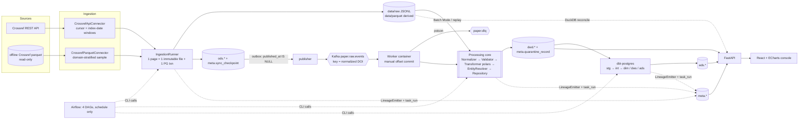

# PaperForge architecture (as built)

> `docs/00-architecture-plan.md` is the original design proposal. This document describes what was actually built and verified;
> where they differ, this one is authoritative (notably: ODS is written *before* Kafka via an outbox, and the raw layer holds
> source-native records instead of verbatim API JSON).

## 1. System overview

Modular monolith (`src/paperforge/`); the only separately running pieces are the Kafka worker, the API, the web console and (optionally) Airflow.

## 2. Guarantees and how they are enforced

| Guarantee | Mechanism | Verified by |
|---|---|---|
| Raw data is immutable and traceable | atomic write (tmp → fsync → rename), never overwritten; sha256 + line counts in `ods.raw_file_manifest`; every `ods`/`dwd.paper_version` row carries `raw_file_id` + `raw_line` | `reconcile`, `test_ingestion.py`, quality rule `r_version_raw_lineage` |
| Resume after interruption | one PG transaction per page: manifest + ODS upsert + checkpoint cursor; orphan files from a crash are overwritten, never duplicated | `test_ingest_interrupted_and_resumed`, orphan-file test |
| No duplicate paper entities | UUIDv7 `paper_id`; `UNIQUE(primary_doi)`; `INSERT … ON CONFLICT DO NOTHING` + retry on lost race | 4-thread concurrency test |
| Idempotent processing | versions keyed on the `source_updated_at` timeline; content hash ignores volatile fields | redelivery / replay tests |
| Out-of-order and late events converge | resolver decides by timeline position, not arrival; all 6 arrival orders give the same state | `test_out_of_order_arrival_converges_to_same_state` |
| At-least-once delivery, offsets after durability | commit only after the DB transaction (and DLQ publish) succeeded | crash-before-commit test, SIGKILL drill |
| Kafka ack ≠ pipeline success | `published_at` set only after ack and only for the sent `payload_hash`; end-to-end gap measured in PostgreSQL (`events status`) | outbox tests |
| One set of rules for batch and streaming | both call `PolarsEngine.process()`; only `Normalizer` holds standardization rules | batch-vs-streaming tests, real-data MD5 comparison |
| Bad data is isolated, not dropped | Error rules → `meta.quarantine_record` (raw record, rule id+version, status), replayable; warnings stay with the version | quality + replay tests |

## 3. Layers

| Layer | Objects | Built by |
|---|---|---|
| ODS | `crossref_works` (latest source-native record per DOI), `ingestion_batch`, `raw_file_manifest`, `ingestion_request` | Python (runner) |
| DWD | `paper`, `paper_identifier`, `paper_author`, `paper_reference`, `paper_version`, `paper_identity_event` | Python + Polars (engine) |
| DIM | `journal` (ISSN-derived key), `publisher` (Crossref member id), `date` | dbt |
| DWS | `journal_statistics`, `publisher_statistics`, `publication_year_statistics`, `data_quality_daily` (incremental), `paper_change_daily` (incremental) | dbt |
| ADS | `paper_search`, `paper_overview`, `quality_overview` | dbt |
| META | `dataset`, `pipeline_run`, `task_run`, `lineage_edge`, `quality_rule`, `quality_result`, `sync_checkpoint`, `quarantine_record` | Python |

Grain, keys, update strategy and upstream of every table: `docs/data_dictionary.md`. ER diagrams: `docs/er.md`. dbt DAG: `docs/dbt-dag.md`.

Dimensions use only explicit identifiers (ISSN co-occurrence, Crossref member id). **Names are never used to merge journals, publishers or authors.**

## 4. Core interfaces (requirement §15)

| Interface | Location | Implementation |
|---|---|---|
| `SourceConnector` | `connectors/base.py` | `CrossrefApiConnector`, `CrossrefParquetConnector` |
| `RawStorage` | `storage/base.py` | `LocalStorage` (S3/MinIO = new adapter) |
| `EventBus` / `EventConsumer` | `events/bus.py` | `KafkaEventBus` |
| `ProcessingEngine` | `processing/engine.py` | `PolarsEngine` |
| `PaperRepository` | `repositories/base.py` | `PgPaperRepository` |
| `QualityValidator` | `quality/base.py` | `PanderaQualityValidator` (Pandera + SQL + roll-up of ingest rules) |
| `LineageEmitter` | `lineage/base.py` | `PgLineageEmitter` (OpenLineage/DataHub = new adapter) |
| `AnalyticsRepository` | `repositories/analytics.py` | `PgAnalyticsRepository` (live queries); DuckDB is used inside it for parquet reconciliation, never for writes |

Interfaces describe inputs, outputs and semantics; replacing a technology means adding an adapter and, if data moves, a migration — not editing business logic.

## 5. Event contract

`event_id, event_type, schema_version, source, source_id, doi, source_updated_at, ingested_at, trace_id, payload_hash, payload`
(pydantic, `extra=forbid`). `event_id = UUIDv5(source, doi, payload_hash)`; key = normalized DOI; raw lineage travels in Kafka headers.
Topics: `paper.raw.events` (3 partitions), `paper.dlq`.

## 6. Orchestration

Airflow (single node, LocalExecutor, metadata in the shared PostgreSQL; Compose profile `airflow`) schedules four DAGs and contains no processing logic:
`crossref_bootstrap`, `crossref_incremental`, `paper_daily_pipeline`, `paper_replay`. Tasks are `paperforge` CLI calls in a separate virtualenv inside the Airflow image (no dependency conflicts); the Kafka consumer is its own Compose service, not an Airflow task.

## 7. Deployment

`docker-compose.yml`: `postgres` (17), `kafka` (4.0, KRaft), `worker`, `api`, `frontend` (nginx) — profile `airflow` adds `airflow`. Docker Desktop VM memory is set to 12 GiB.
Commands: `make up | ingest LIMIT=… | transform | dbt | quality | publish | replay | demo | test | test-all | down` (see README).

## 8. Growth path (not built)

LocalStorage → S3/MinIO adapter · Polars → Spark/Flink · PostgreSQL analytics → ClickHouse · Parquet → Iceberg · PG lineage → OpenLineage/DataHub · more sources → new `SourceConnector` + a field-mapping in `Normalizer`.
