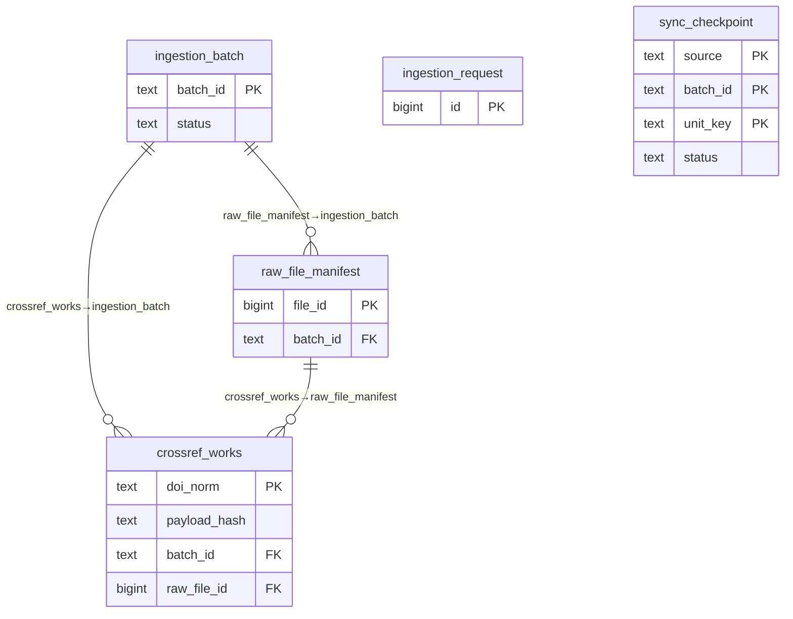
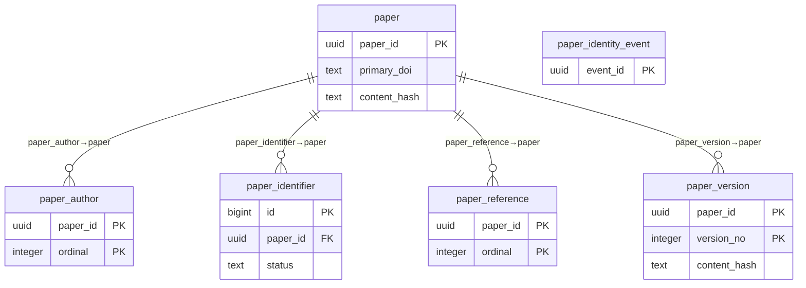
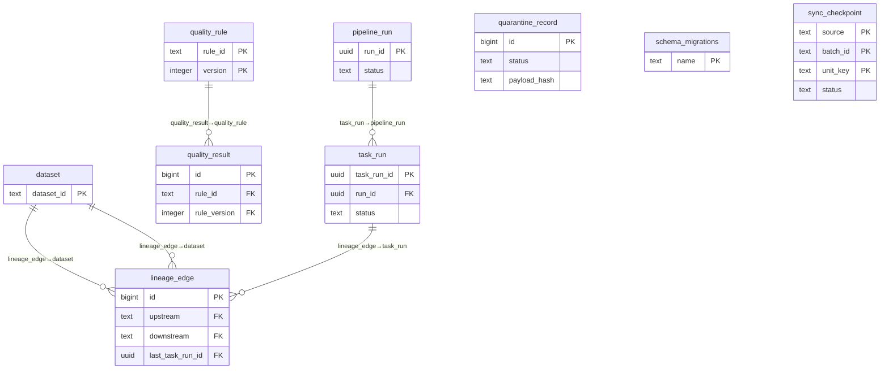
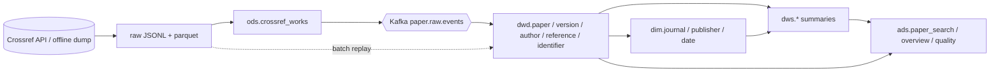

# Entity-relationship diagrams

Generated from the foreign keys and primary keys in PostgreSQL (`scripts/gen_docs.py`). Only key columns are shown; see the data dictionary for all columns.

## Raw layer and ingestion bookkeeping (ods, meta.sync_checkpoint)

## Standardized layer (dwd)

## Governance (meta)

## Logical flow between layers

